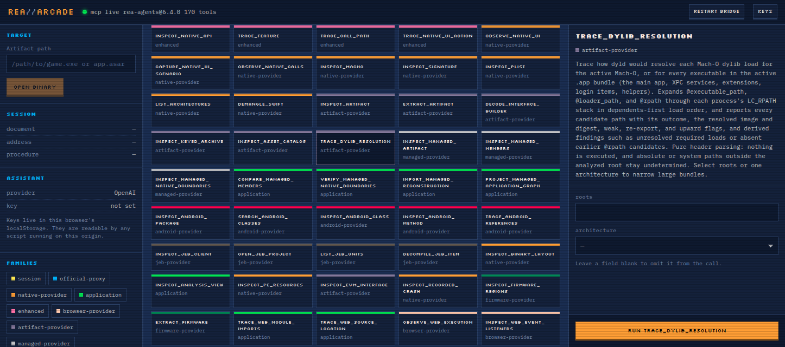

# REA//ARCADE

A cartridge-style workbench for driving the [REA](https://github.com/morluto/rea) reverse-engineering
MCP server against game artifacts. All 170 tools, browsable and runnable, with an optional AI
assistant that explains the output.



Every tool is a cartridge whose top strip carries its REA capability-family colour, so you can see
at a glance whether something needs a phone on ADB, a native decompiler, or nothing at all.

```
rea-arcade/
├── server/
│   ├── index.js          Express bridge — HTTP in, MCP stdio out
│   ├── rea-mcp.js        MCP client: spawns `rea-agents@<v> mcp`, speaks newline-delimited JSON-RPC
│   └── tool-surfaces.json  Surface → family map, snapshotted from `rea doctor`
└── src/
    ├── App.jsx           State and orchestration
    ├── lib/              api, settings, ai, surfaces
    └── components/       Topbar, TargetRail, ToolGrid, ArgForm, Inspector, AskPanel, SettingsDialog
```

## Why there is a server

REA ships **only a stdio MCP server** — `npx -y rea-agents@6.4.0 mcp` is a subprocess speaking
JSON-RPC over stdin/stdout. There is no HTTP endpoint, and a browser cannot spawn a process. The
Node bridge owns that subprocess and relays calls over HTTP. This is the only piece of architecture
that is not negotiable.

## Requirements

- **Node 22.19+ / 24.11+ / 26+.** REA hard-fails on older Node; the bridge inherits your PATH, so run
  it from a shell where `node -v` satisfies this.
- REA installed and registered with your agent (`npx rea-agents@latest setup`), or just reachable
  via npx — the bridge spawns it directly and does not depend on your agent config.

## Run

```bash
cd rea-arcade
npm install
npm run dev          # bridge on :8787, UI on :5173
```

Production-style single process:

```bash
npm run build
node server/index.js   # serves the built UI on :8787
```

## HTTP API

| Route | Purpose |
|---|---|
| `GET /api/health` | Bridge + MCP subprocess status |
| `GET /api/tools` | All 170 tools with schemas (cached; `?refresh=1` to refetch) |
| `POST /api/call` | `{ name, arguments }` → REA tool result |
| `POST /api/restart` | Restart the MCP subprocess |

## AI keys

Set provider, model, base URL and key in the **keys** dialog. They are written to `localStorage`
under `rea-arcade.settings.v1`, unencrypted, per your request.

**This is fine for a local tool and unsafe for anything deployed.** Any script running on this
origin can read `localStorage`. If you ever host this, move key handling behind the bridge or drop
the AI panel entirely. Ollama needs no key and never leaves the machine.

## Tool colours

Each cartridge's top strip carries its REA `surface` family colour, from the TIC-80 palette. The
legend is in the left rail. `android`, `adb` and `apktool` share one crimson because they are one
capability domain.

`surface` is not returned by `tools/list`; it comes from `rea doctor`'s catalog, snapshotted into
`server/tool-surfaces.json`. If REA adds tools in a later release, refresh it with:

```bash
npx -y rea-agents@6.4.0 doctor --json > /tmp/doctor.json
node -e "const d=require('/tmp/doctor.json');const m={};d.identity.catalog.tools.forEach(t=>{if(t.name&&t.surface)m[t.name]=t.surface});require('fs').writeFileSync('server/tool-surfaces.json',JSON.stringify({_source:'generated from rea doctor catalog',map:m},null,0))"
```

New tools still work without this — the bridge falls back to inferring a family from the tool name.

## What is not configured

No Ghidra, Hopper or IDA. Everything that does not need a native decompiler works: JS/Electron
static analysis, artifacts, strings, session bookkeeping, evidence bundles. **Native disassembly and
decompilation (`procedure_pseudo_code`, `disassemble`, native `inspect_*`) will fail** until a
provider is configured:

```bash
export GHIDRA_INSTALL_DIR=/path/to/ghidra
npx -y rea-agents@6.4.0 setup
npx -y rea-agents@6.4.0 doctor --provider ghidra --json
```# REA-gaming-development-workspace
